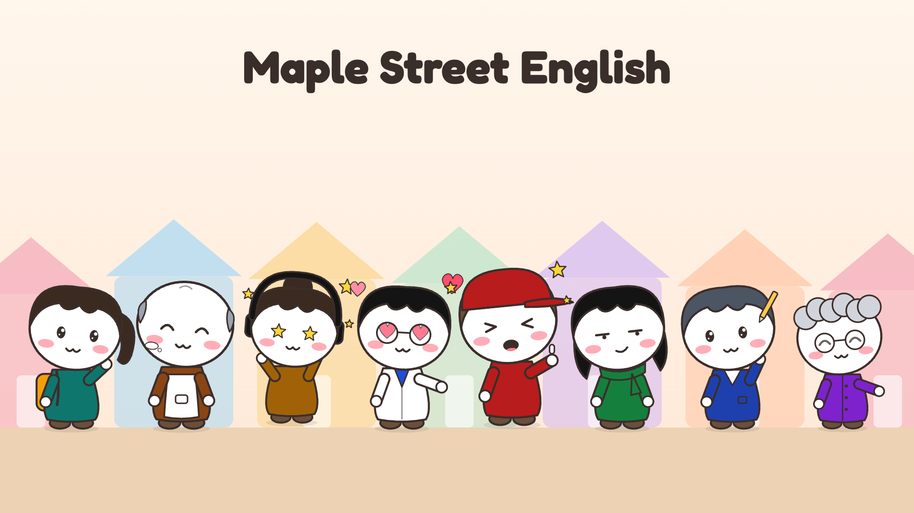

# Maple Street English

**Studio otomatis untuk channel YouTube belajar bahasa Inggris: sitkom animasi chibi di satu jalan, setiap episode di rumah atau toko yang berbeda.**

[English → README.md](README.md)



Dari satu ide episode sampai folder siap upload: naskah dialog multi-karakter, suara berbeda untuk setiap karakter, adegan animasi, caption dengan nama pembicara, segmen latihan bicara ("Your turn") dengan suara lebih lambat dan pujian, thumbnail, judul, deskripsi, chapter dan pinned comment.

## Isi

| Bagian | Isi |
|---|---|
| [`channels/maplestreet/CHANNEL.md`](channels/maplestreet/CHANNEL.md) | channel bible: audiens, level, 8 pemeran, 7 tempat, format episode, rencana Season 1 |
| [`channels/maplestreet/YOUTUBE-SETUP.md`](channels/maplestreet/YOUTUBE-SETUP.md) | membangun channel di YouTube Studio: branding, deskripsi, playlist, pengaturan upload |
| [`MONETISASI.md`](MONETISASI.md) | strategi monetisasi dan target 90 hari |
| `channels/maplestreet/brand/` | brand.json (warna, suara per karakter, tampilan karakter, tempat, YouTube) + logo, banner, foto profil, watermark |
| `channels/maplestreet/examples/first-breakfast/` | Episode 2 lengkap: script, brief, storyboard |
| `engine/`, `tools/`, `themes/` | engine render (berbasis PaperFold Studio) |
| [`docs/ENGINE.id.md`](docs/ENGINE.id.md) | dokumentasi lengkap engine (instalasi, perintah, troubleshooting) |

## Dua skill

| Skill | Tugas | Model |
|---|---|---|
| **maplestreet-scriptwriter** | menulis naskah episode/Shorts + brief (frasa target, judul, deskripsi, rencana adegan) | model kuat |
| **maplestreet-studio** | suara, storyboard, render, thumbnail, folder upload | model murah cukup |

## 1. Kebutuhan

Python 3.9+ dengan numpy, Node.js 22+, ffmpeg, Google Chrome, dan aplikasi [Voicebox](https://github.com/jamiepine/voicebox) dengan model Kokoro (suara gratis, lokal). Langkah instalasi per sistem operasi: [`docs/ENGINE.id.md`](docs/ENGINE.id.md) bagian 4-6. `tools/logo.py` dan `tools/channel_art.py` butuh Python 3.12+.

```bash
python3 -m pip install numpy
python3 tools/pf.py doctor
```

## 2. Build dan pasang skill

```bash
python3 tools/package.py channel maplestreet --install claude        # Claude Code
python3 tools/package.py channel maplestreet --install antigravity   # Google Antigravity
python3 tools/package.py channel maplestreet --install all           # semua AI tool yang didukung
python3 tools/package.py channel maplestreet --zip                   # file .skill untuk Claude.ai
```
Selalu edit di folder ini (sumber), lalu build ulang. Jangan edit salinan yang sudah terpasang.

## 3. Suara karakter

Setiap karakter punya suara Kokoro sendiri di `brand.json → voice.cast` (Mia `af_heart`, Walter `am_michael`, Grace `af_bella`, Narator `am_liam`, ...). Profil Voicebox dibuat otomatis saat video pertama. Untuk mendengar pilihan suara lain:
```bash
python3 tools/voicebox.py --brand channels/maplestreet/brand audition --voices af_heart,af_bella,af_sky
```

## 4. Membuat episode

Di AI tool Anda (percakapan baru untuk setiap video):
```
/maplestreet-scriptwriter write episode 3 from the season plan: Where's the post office?
/maplestreet-studio make a 16:9 video from videos/wheres-the-post-office/script.txt
```
Hasilnya ada di `videos/<topic>/publish/`; buka `UPLOAD.md` di folder itu.

Format naskah (detail di `templates/scriptwriter/SCRIPT-GUIDE.md`):
```
[STORY]
MIA: Good morning! Something smells amazing in here.
WALTER: That's the cinnamon rolls.
[REPEAT]
NARRATOR: Your turn. Listen and repeat.
MIA: Can I get a coffee, please?
NARRATOR: Great job!
```
- `[STORY SLOW]` dan `[REPEAT]`: baris karakter otomatis diperlambat (`voice.slow_segments`).
- Setelah setiap baris karakter di `[REPEAT]` ada jeda 3,5 detik untuk penonton (`voice.pause_segments`); frasanya tetap tampil dengan hitungan mundur mikrofon, lalu pujian.

## 5. Adegan khusus Maple Street

| Adegan | Isi |
|---|---|
| `dialogue` | 1-3 karakter di sebuah tempat; yang bicara bergerak dan mendapat balon kata |
| `location` | jalan Maple Street, kamera terbang ke rumah/toko, judul episode + badge level |
| `repeat` | latihan bicara: kartu frasa, mic countdown, pujian dengan efek bintang |

Ditambah semua adegan engine (`bigtext`, `versus`, `list`, `title`, `outro`, ...). Contoh JSON: [`reference/STORYBOARD.md`](reference/STORYBOARD.md).

## 6. Tampilan

- `"character_style": "chibi"`: karakter gaya stiker (kepala besar, pipi merona, 11 ekspresi, emote 💦 ❓ ❤️ 💢 💤 ✨).
- Tema `maple`: latar pastel, lantai kayu, interior per jenis tempat (bakery, pharmacy, shop, home, busstop, street).
- Tampilan tiap karakter (rambut, aksesori, warna, tinggi) di `voice.cast.<NAMA>.look`; tempat di `places`.

## 7. Aset channel YouTube

```bash
python3 tools/logo.py --brand channels/maplestreet/brand          # logo, wordmark, watermark
python3 tools/channel_art.py --brand channels/maplestreet/brand   # banner, foto profil, cast-lineup (sesudah logo.py)
```
Lalu ikuti [`channels/maplestreet/YOUTUBE-SETUP.md`](channels/maplestreet/YOUTUBE-SETUP.md).

## 8. Lisensi

Font di `assets/fonts/` berlisensi SIL OFL (lihat `assets/fonts/OFL-LICENSE.txt`). Engine berasal dari PaperFold Studio.
